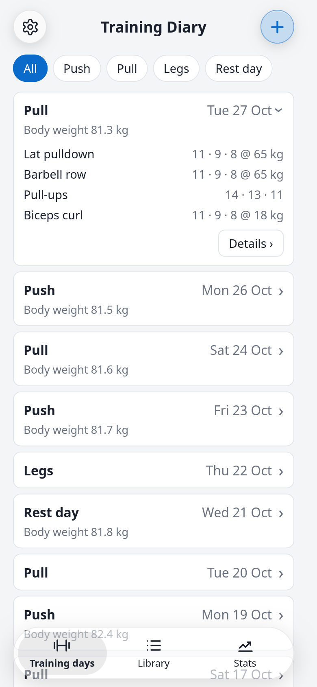
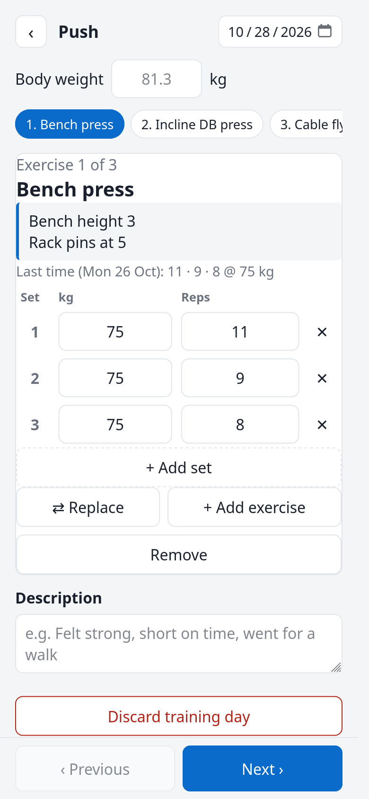
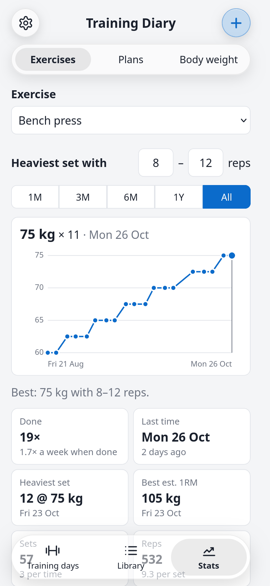
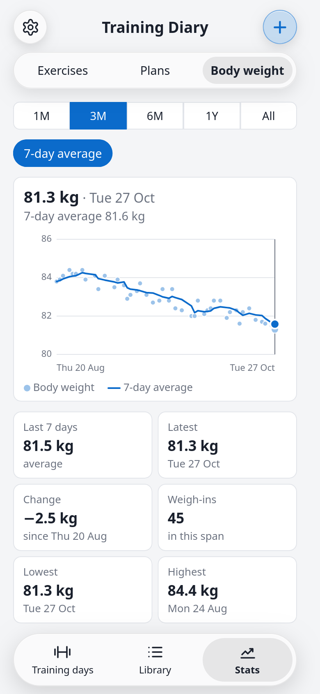
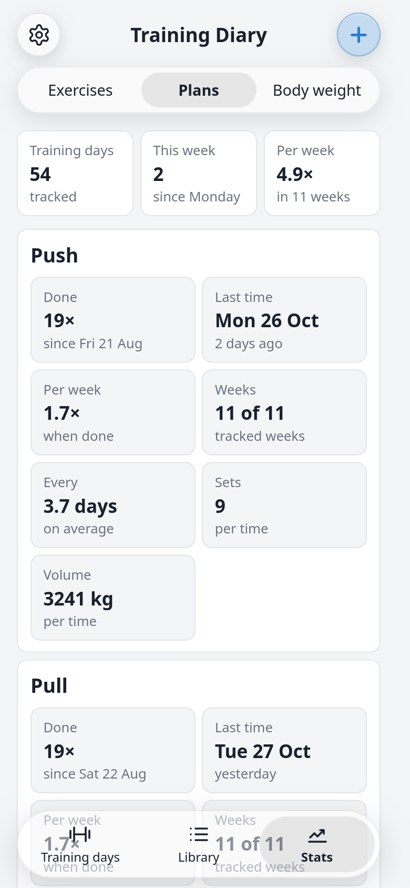
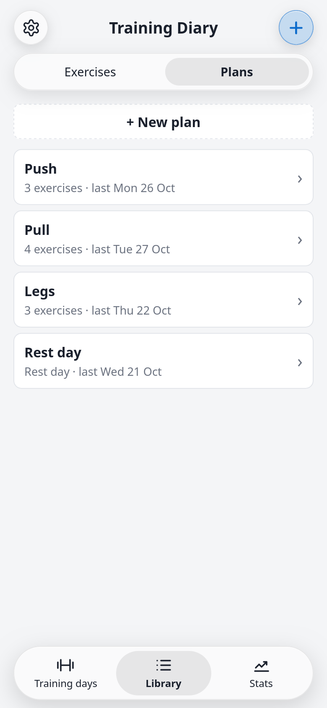

# Training Diary

A gym training diary that runs in the browser and installs to your phone's home
screen like an app. Set up your exercises and plans (e.g. Push, Pull, Legs), track
every training day set by set, and follow your progress, how often you train and
your body weight. It works offline, needs no account, and keeps all data on your
device.

**Open the app:** https://hempllll.github.io/training-diary/

<p>
  
  
  
</p>
<p>
  
  
  
</p>

<sub>Screenshots with made-up demo data.</sub>

## Contents

- [Installation](#installation)
- [Features](#features)
- [Compatibility](#compatibility)
- [Your data](#your-data)
- [Development](#development)

## Installation

The app is a website that you add to your home screen once. After that it opens
full screen like any other app and works without internet.

### iPhone and iPad

1. Open **https://hempllll.github.io/training-diary/** in **Safari**. Other browsers
   on iOS can add it too since iOS 16.4, but Safari is the safe choice.
2. Tap the **Share** button (the square with the arrow pointing up). On iOS 26 it can
   be hidden behind the **⋯** button next to the address bar.
3. Scroll down and tap **Add to Home Screen**. Leave **Open as Web App** switched on
   if it is shown.
4. Tap **Add**. The Training Diary icon appears on your home screen; open the app from
   there.

### Android

1. Open **https://hempllll.github.io/training-diary/** in **Chrome**.
2. Tap the **⋮** menu and choose **Add to Home screen** and then **Install** (some
   versions call it **Install app**).
3. Open the app from its icon on the home screen or in the app drawer.

### Computer

- **Chrome or Edge:** open the address and click the install icon at the right end of
  the address bar (or menu → *Cast, save and share* → *Install page as app*).
- **Safari on a Mac (macOS 14 or later):** *File* → *Add to Dock*.
- Or simply use it in a browser tab.

### Updates

New versions are installed automatically: the app checks for one whenever it is
opened with internet and uses it from the next start. To get an update right away,
close the app completely and open it again. Your data is kept across updates.

### Uninstalling

Delete the icon like any other app. **This also deletes the diary stored in it**, so
export a backup first (see [Your data](#your-data)).

## Features

The app has three tabs at the bottom: **Training days**, **Library** and **Stats**.
At the top are the **settings gear** (left) and the **+** button (right).

### Training days (home)

- All tracked training days, newest first. Each card shows the plan, the date and
  your body weight that day.
- **Tap a card** to open it: it shows the day's description and every exercise with
  its sets, written as *reps @ weight*, grouped by weight in the order done (e.g.
  `12 @ 40 kg, 11 · 9 · 8 @ 50 kg`). Several cards can be open at once; the day you
  just saved opens by itself.
- **Details ›** shows the whole day, where you can **edit** or **delete** it.
- The chips at the top filter by plan (several at once); **All** shows everything.
  Plans you deleted still show up here if they were tracked.

### Tracking a training day

- Tap **+** (from any tab) and choose a plan. If a training day is in progress,
  **+** resumes it instead; if you have no plans yet, it creates the first one.
- The exercises come one after the other in the plan's order. Each set has a weight
  (kg) and reps, **pre-filled with what you did last time**, which is also shown
  above the sets. Add or remove sets as needed. Weights accept a decimal comma
  (`62,5`); 0 kg means a bodyweight exercise.
- The exercise's description (e.g. machine settings) is shown while you train it.
- Jump between exercises with the row of names, or **Previous** / **Next**.
- Machine taken or broken? **⇄ Replace** swaps the exercise for another one, **+ Add
  exercise** adds one, **Remove** drops one. These changes are for this training day
  only; the plan stays as it is. A new exercise can be created right there by typing
  its name.
- Optional: your **body weight** (the last one entered is shown as a hint), a
  **description** of the day (e.g. "Short on time"), and a different **date**.
- **Finish** saves the day. **‹** (Leave) keeps it in progress to continue later,
  even if you close the app. **Discard training day** throws it away.
- Editing a saved day works the same way and ends with **Save changes**.

### Rest days

A plan without exercises is a rest day. Tracking it records the day with your body
weight and a description (e.g. "Long walk, 8 km").

### Library

The glass menu at the top switches between **Exercises** and **Plans**.

- **Exercises:** add exercises by name and see when you last did each one and what.
  Tap one to see its plans and what you did last time, to **edit** its name and
  description, to **delete** it (it is removed from its plans, but tracked training
  days keep it), or to open its **Stats ›**.
- **Plans:** **+ New plan** creates one, tap a plan to edit it: rename it, add
  exercises (existing or new ones), remove them, put them in order with the arrows,
  or delete the plan. Tracked training days are never changed by editing a plan.

### Stats

The glass menu at the top switches between **Exercises**, **Plans** and **Body weight**.

- **Exercises:** pick an exercise (deleted ones with tracked sets are listed too).
  The chart shows the **heaviest set within a rep range** at every training day;
  the range is yours to choose (8–12 reps to start with). Exercises done without
  weight chart their most reps per set instead. Below: how often it was done (and
  per week, in the weeks it was done), first and last time, heaviest set, best
  estimated one-rep max (Epley formula), total sets, reps and volume (weight × reps),
  and the full history.
- **Plans:** training days tracked in total, this week, and per week (over the weeks
  you trained). Per plan: how often it was done, the last time, how often per week
  in the weeks it was done, in how many of the tracked weeks it was done, the
  average days between two times, and the average sets and volume per time.
  **Swaps** counts exercises replaced or added while tracking it.
- **Body weight:** every entered body weight as a chart, with the **7-day average**
  as a line (switch it off with the button above the chart). Below: the average of
  the last 7 days, the latest value, and the change, lowest and highest value in the
  chosen time span.

Charts can show the last month, 3 months, 6 months, year, or everything (**1M … All**).
Tap or drag across a chart to read the value of any day; the newest is shown first.

### Moving around

- **Tap a tab** to open its first page. **Hold Library or Stats** to pick one of its
  pages from a small menu.
- **Swipe sideways** across a page to go to the next or previous page, through all
  tabs in order (Training days → Exercises → Plans → Stats …).
- **Drag along the tab bar** to slide its highlight to another tab.
- Short notifications ("Saved Push") appear at the top right and fade out; tap one to
  dismiss it.
- Light and dark mode follow your phone's setting, and animations are switched off
  when your phone is set to reduce motion.

## Compatibility

| Device | Works with |
| --- | --- |
| iPhone / iPad | iOS / iPadOS 16.4 or later (Safari) |
| Android | Chrome 111 or later (other Chromium browsers of the same age) |
| Computer | Chrome / Edge 111+, Firefox 114+, Safari 16.4+ |

Older browsers may load a blank page. Without internet, everything works once the
app has been opened online one time.

**Data compatibility:** every update keeps the data stored by any earlier version and
reads backup files exported by any earlier version. The first time an update converts
older data, it also keeps a copy of the original (in the browser storage under
`training-diary.backup.v<N>`). If stored data can't be read, the app shows an error
page with a button to download that data and saves nothing over it.

## Your data

- Everything is stored **only on your device**, in the browser storage of the app.
  There is no account and no server; nothing is sent anywhere.
- On iPhone, the home screen app keeps its data apart from Safari: data entered in
  a Safari tab does not show up in the installed app and the other way round.
- **Backup:** tap the gear → **Backup**. **Export** saves the whole diary as a
  `training-diary-<date>.json` file (on iPhone: choose *Save to Files*). **Import
  file…** restores one; it replaces everything stored, after asking.
- **New phone:** export on the old one, send the file to the new one (AirDrop, mail,
  cloud), install the app there and import the file.
- Weights are in kilograms; dates follow your phone's local time.

## Development

Built with Vite, React and TypeScript, tested with Vitest and Testing Library,
linted with oxlint. Needs Node.js 22 or later.

```bash
npm install         # install dependencies
npm run dev         # start the dev server (http://localhost:5173/training-diary/)
npm test            # run the test suite once
npm run test:watch  # run tests in watch mode
npm run lint        # lint with oxlint
npm run build       # type-check + production build to dist/
npm run preview     # serve the production build locally
```

To try the app on a phone during development, run `npm run dev -- --host` and open
the network address it prints on a phone in the same Wi-Fi.

The code layout and rules (above all: stored data must keep loading in every version)
are described in [CLAUDE.md](CLAUDE.md); compatibility with the data of every released
version is checked by `src/storage/__tests__/compatibility.test.ts`.

### Deployment

Pushing to `main` triggers [.github/workflows/deploy.yml](.github/workflows/deploy.yml),
which builds the app and publishes `dist/` to GitHub Pages (repository Settings →
Pages → Source: GitHub Actions). Pull requests run lint, tests and build in
[.github/workflows/ci.yml](.github/workflows/ci.yml).

## License

[MIT](LICENSE)
